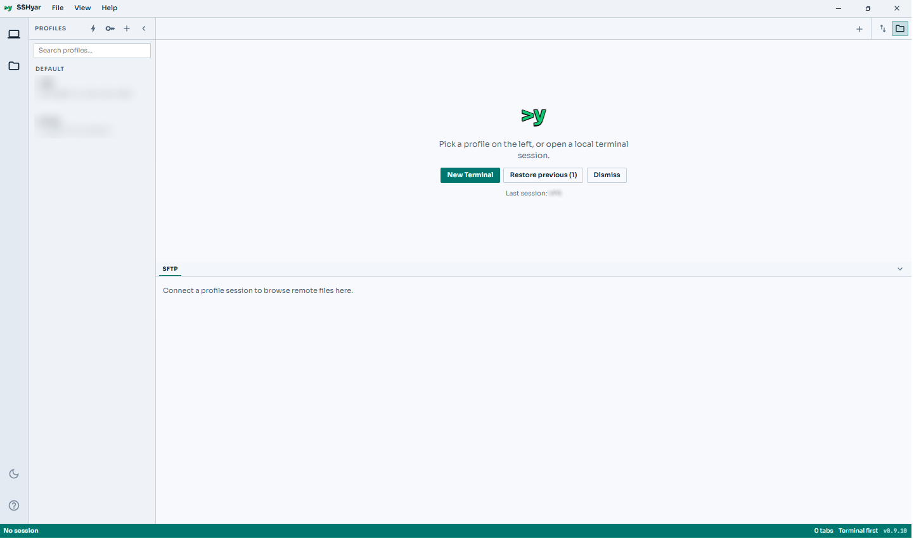
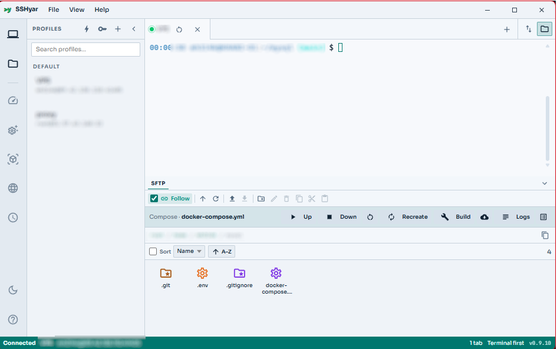
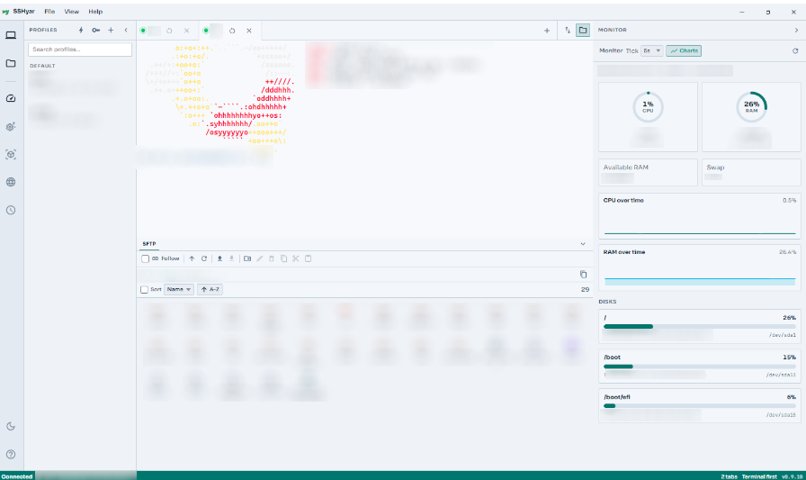
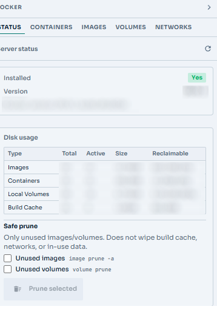

# SSHyar

[English](README.md) | [فارسی](README.fa.md) | [العربية](README.ar.md) | [Русский](README.ru.md) | [简体中文](README.zh-CN.md)

**SSH، SFTP و ابزارهای سرور در یک پنجره دسکتاپ — بدون agent روی هاست.**

**ویندوز و لینوکس** · متن‌باز · vault رمزنگاری‌شده روی *دستگاه خودت*

**[دانلود آخرین نسخه](https://github.com/mh314k/sshyar/releases/latest)**

## تصاویر

  

<table>
  <tr>
    <td align="center" valign="top" width="50%">
       
      ترمینال + SFTP
    </td>
    <td align="center" valign="top" width="50%">
       
      Monitor
    </td>
  </tr>
  <tr>
    <td align="center" colspan="2">
       
      Docker
    </td>
  </tr>
</table>

## چرا SSHyar

- **یک پنجره** — ترمینال SSH، SFTP گرافیکی و ابزارهای اختیاری سرور کنار هم (نه سه برنامه جدا).
- **چیزی روی سرور نصب نمی‌شود** — بدون agent، بدون پوشه `.sshyar`، بدون فایل پنهان. پلاگین‌ها فقط فرمان‌های کوتاه روی جلسه SSH می‌زنند.
- **رمزها پیش خودت می‌مانند** — vault با AES-GCM (رمز اصلی اختیاری) و بکاپ قابل‌حمل رمزنگاری‌شده.
- **پنل سرور وقتی لازم است** — Docker، Nginx، systemd، cron و Monitor زنده — برای هر پروفایل جدا.
- **آپدیت داخل برنامه** — دانلود اینستالر از GitHub Releases و اجرای آن با یک کلیک.

## مقایسه با گزینه‌های دیگر

| | **SSHyar** | شبیه Termius / Tabby | WinSCP + ترمینال | کلاس MobaXterm |
|---|------------|----------------------|------------------|----------------|
| SSH + SFTP در یک پنجره دسکتاپ | بله | متفاوت | اپ‌های جدا | بله |
| پنل Docker / Nginx / systemd / Monitor | بله | نادر | خیر | محدود |
| Agent / ردپا روی سرور | **هیچ** | معمولاً هیچ | هیچ | گاهی افزونه |
| Vault محلی + بکاپ قابل‌حمل | بله | اغلب ابری / حساب | کلید جای دیگر | متفاوت |
| بیلد ویندوز **و** لینوکس | بله | متفاوت | بیشتر ویندوز | بیشتر ویندوز |
| متن‌باز (GPL) | **بله** | اغلب proprietary | WinSCP هم GPL است | لایه‌های پولی |

**بهترین انتخاب وقتی** کلاینت دسکتاپ رایگان می‌خواهی که پروفایل‌ها آفلاین بمانند، agent روی سرور نگذارد، و کنار شل پنل فایل و Docker/هاست داشته باشی.

## دریافت

1. **[Releases](https://github.com/mh314k/sshyar/releases/latest)** را باز کن.
2. برای سیستم‌عاملت دانلود کن:
   - **ویندوز** — `.msi` (ترجیحی) یا `.exe`
   - **لینوکس** — `.AppImage` یا `.deb`
3. نصب / اجرا. کلاینت OpenSSH باید روی سیستم باشد.

بیلد از سورس اختیاری است — [docs/develop.md](docs/develop.md).

## جامعه

- اگر وقتت را ذخیره کرد، ریپو را **Star** کن تا دیگران هم پیدا کنند.
- برای باگ، ایده یا سؤال **[ایشو باز کن](https://github.com/mh314k/sshyar/issues)**.
- **مشارکت** — مستندات، ترجمه و اصلاحات خوش‌آمدند. از [docs/develop.md](docs/develop.md) شروع کن.

## مجوز

نرم‌افزار آزاد تحت **GNU GPL v3 یا جدیدتر**. [LICENSE](LICENSE).
